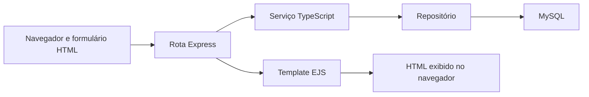
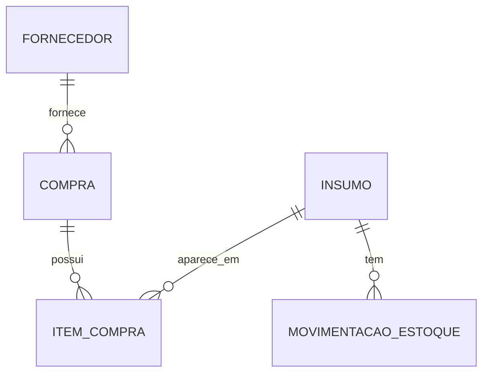

# Manual do Gerenciador de Insumos do RU

Este manual é para quem vai ler, testar ou apresentar o projeto pela primeira vez. Comece pelo exemplo de cadastro e, ao chegar na parte de banco de dados, acompanhe uma saída de estoque.

## 1. O que o sistema faz

O Restaurante Universitário pode **cadastrar insumos**, **manter os dados dos fornecedores** e **registrar entradas e saídas de estoque**. A tela de movimentações mostra o saldo por insumo e o histórico. Compras e itens de compra existem no banco para representar de quem se comprou e o que foi comprado. Na versão atual, esses dois conjuntos são carregados pelo script SQL. A interface registra um recebimento diretamente como uma entrada de estoque.

| Tecnologia | Papel no projeto |
| --- | --- |
| Node.js | Executa o servidor no computador. |
| TypeScript | Define os formatos dos dados e permite verificar os tipos antes de executar a versão compilada. |
| Express | Recebe os pedidos do navegador e encaminha cada endereço para a função correspondente. |
| EJS | Monta as páginas HTML no servidor com os dados da rota. |
| Bootstrap e CSS | Dão aparência às tabelas, aos formulários e às mensagens. |
| MySQL e `mysql2` | O MySQL armazena os registros e aplica as restrições das tabelas. O pacote `mysql2` permite ao Node executar SQL. |
| MySQL Workbench | Permite consultar os dados e visualizar o modelo entidade-relacionamento. |

## 2. Como rodar e conferir

1. Abra a pasta do projeto no VS Code. Rode `npm install` na primeira vez.
2. Prepare o schema, o usuário e o arquivo `.env` conforme a seção **Executar com MySQL** do [README](README.md#executar-com-mysql). O arquivo `.env` registra o host, a porta, o usuário, a senha e o nome do banco. Use a senha do usuário da aplicação e mantenha o arquivo fora do Git.
3. Rode `npm run dev` e abra [http://localhost:3000](http://localhost:3000). Se o PowerShell bloquear `npm.ps1`, use `npm.cmd run dev`. O terminal deve exibir `Conectado ao MySQL.`.
4. Para executar a versão compilada, rode `npm run build` e depois `npm start`. Encerre o servidor anterior com `Ctrl+C` antes de iniciar outro na mesma porta.

### Como ler o código pela primeira vez

Abra [o formulário de insumos](views/insumos/form.ejs), encontre os atributos `action` e `method`, e siga para a [rota de insumos](src/insumos/routes.ts). Depois, procure o método `criar` no [serviço](src/insumos/service.ts) e no [repositório MySQL](src/insumos/mysql-repository.ts).

A **rota** recebe os campos e decide qual resposta enviar. O **serviço** valida os dados e solicita a operação. O **repositório** consulta ou grava no MySQL. Cada **interface TypeScript** especifica as operações que o repositório deve oferecer.

## 3. Um cadastro do começo ao fim

Imagine que alguém cadastre **Lentilha** com unidade **kg**.

1. O navegador pede `GET /insumos/novo`. A rota usa o EJS para montar o formulário vazio.
2. Ao clicar em **Cadastrar insumo**, o formulário envia `POST /insumos` com `nome`, `descricao` e `unidadeMedida`.
3. A rota lê `requisicao.body` e chama `servico.criar`. O serviço lê os campos, remove espaços nas pontas e verifica nome, descrição e unidade. Um campo inválido faz o formulário reaparecer com status HTTP `422`, os valores digitados e a mensagem do campo.
4. Com dados válidos, o repositório executa um `INSERT` com parâmetros `?`. Os campos digitados são enviados como valores da consulta, separados do comando SQL. O MySQL gera o identificador do novo insumo e grava o registro na tabela `insumo`.
5. A rota responde com um redirecionamento `303` para `/insumos?status=criado`. O navegador faz um novo `GET`, e a listagem carrega os dados atualizados. Atualizar essa página repete a consulta, sem reenviar o cadastro.

Na busca, `GET /insumos?q=lentilha` leva o termo ao repositório. A edição usa `GET` para abrir o formulário preenchido e `POST` para gravar, ambos em `/insumos/:id/editar`. A exclusão usa o mesmo princípio em `/insumos/:id/excluir`. O primeiro acesso mostra a confirmação e o envio confirma a operação. Em `/fornecedores`, o fluxo é equivalente. Um identificador malformado gera `400`, e um registro ausente gera `404`.

## 4. As cinco tabelas e seus relacionamentos

Os registros ficam nas tabelas InnoDB do schema `gerenciador_ru`, no servidor MySQL. Reiniciar o Node encerra as conexões do aplicativo. Quando ele volta, consulta os mesmos registros no banco.

Uma **chave primária (PK)** identifica uma linha na própria tabela. Uma **chave estrangeira (FK)** aponta para uma linha de outra tabela. Por exemplo, `compra.id_fornecedor` aponta para `fornecedor.id_fornecedor`.

Leia a primeira linha do diagrama assim. Cada compra pertence a um fornecedor, e cada fornecedor pode ter zero ou várias compras. O mesmo padrão vale para as outras relações. A tabela `item_compra` liga uma compra a um insumo e guarda a quantidade e o preço daquele item.

| Tabela | O que representa | Campos principais |
| --- | --- | --- |
| `insumo` | Produto utilizado no RU | `id_insumo` (PK), `nome`, `descricao`, `unidade_medida` |
| `fornecedor` | Contato de quem fornece os produtos | `id_fornecedor` (PK), `nome`, `email`, `telefone` |
| `compra` | Compra feita de um fornecedor em uma data | `id_compra` (PK), `id_fornecedor` (FK), `data_compra` |
| `item_compra` | Insumo comprado e suas condições | `id_item_compra` (PK), `id_compra` (FK), `id_insumo` (FK), `quantidade`, `preco_unitario` |
| `movimentacao_estoque` | Entrada ou saída de um insumo | `id_movimentacao` (PK), `id_insumo` (FK), `tipo`, `quantidade`, `data_movimentacao`, `observacao` |

O DDL usa `ON DELETE RESTRICT`. Um fornecedor com compras vinculadas fica protegido contra exclusão, assim como um insumo com itens de compra ou movimentações. O backend traduz essas recusas em mensagens de conflito (`409`). O projeto também protege a unidade de medida do insumo vinculado, porque mudar kg para litros alteraria o significado do histórico. O nome e a descrição continuam editáveis.

No Workbench, abra **Schemas → gerenciador_ru → Tables**. Use **Select Rows** no menu de contexto para abrir os registros. Para obter o diagrama do banco instalado, use **Database → Reverse Engineer**, selecione o schema `gerenciador_ru` e mantenha **Place imported objects on a diagram** marcado. Salve o modelo como `.mwb` pelo menu **File → Save**.

## 5. Como o estoque funciona

**Saldo = soma das entradas − soma das saídas.** O sistema calcula esse valor a partir do histórico. Um insumo novo aparece com saldo zero. O DML cria uma movimentação de entrada para cada item recebido, portanto somar também a tabela `item_compra` duplicaria a quantidade recebida.

No formulário de movimentações, o JavaScript atualiza o saldo exibido quando a pessoa troca o insumo selecionado. Esse valor é informativo e pode mudar até o envio. O servidor verifica o saldo atual antes de registrar a saída.

O serviço aceita quantidade positiva com até três casas decimais e aceita tanto `1,250` quanto `1.250` como um inteiro e 250 milésimos. No MySQL, a quantidade é armazenada em `DECIMAL(12,3)`. Para comparar o saldo com a quantidade solicitada, o repositório de estoque converte os valores em inteiros em milésimos.

### Como duas saídas simultâneas são tratadas

Considere um saldo de **10 kg** e duas pessoas tentando retirar **7 kg** ao mesmo tempo.

1. O repositório [de estoque MySQL](src/estoque/mysql-repository.ts) abre uma transação. O comando `SELECT ... FOR UPDATE` bloqueia a linha do insumo até a transação terminar.
2. A primeira solicitação consulta os 10 kg, grava a saída de 7 kg e confirma com `commit`. O saldo passa a 3 kg.
3. A segunda solicitação aguarda o bloqueio. Quando consegue prosseguir, consulta o saldo de 3 kg e recebe o erro de estoque insuficiente. O repositório usa `rollback` quando a operação falha.
4. A conexão volta para o conjunto de conexões reutilizáveis, chamado **pool**. O histórico mantém somente a saída confirmada.

## 6. Para que serve cada arquivo

### Inicialização, configuração e utilitários

| Arquivo | O que faz |
| --- | --- |
| [README.md](README.md) | Explica como instalar dependências, executar, compilar e configurar o projeto com MySQL. |
| [package.json](package.json) | Declara o nome do projeto, as dependências e os comandos `dev`, `build` e `start`. |
| [package-lock.json](package-lock.json) | Registra as versões resolvidas das dependências para reproduzir a instalação. O npm mantém esse arquivo. |
| [tsconfig.json](tsconfig.json) | Configura a compilação de `src/` para `dist/` e as verificações de tipos. Os imports usam `.js`, a extensão dos arquivos que o Node executa depois da compilação. |
| [.gitignore](.gitignore) | Exclui do controle de versão arquivos locais como `.env`, `node_modules/` e `dist/`. |
| [.env.example](.env.example) | Modelo sem senha para configurar a conexão local com o MySQL. |
| [src/server.ts](src/server.ts) | É a entrada do programa. Valida a porta, prepara os dados, inicia o servidor e encerra a conexão do banco ao parar. |
| [src/app.ts](src/app.ts) | Monta o Express, configura o EJS, publica arquivos estáticos, conecta as três rotas às suas URLs e trata erros gerais. Também fornece aos templates a formatação de data e quantidade. |
| [src/database.ts](src/database.ts) | Cria o pool MySQL, confere a conexão com `SELECT 1` e entrega os repositórios SQL. |
| [src/repositories.ts](src/repositories.ts) | Reúne os três contratos em `Repositorios`. |
| [src/shared/forms.ts](src/shared/forms.ts) | Lê campos de texto e interpreta identificadores positivos. |
| [src/shared/errors.ts](src/shared/errors.ts) | Define `ApplicationError`, com mensagem e status HTTP, e `ValidationError`, que identifica os campos inválidos. |

### Insumos

| Arquivo | O que faz |
| --- | --- |
| [src/insumos/insumo.ts](src/insumos/insumo.ts) | Define as unidades permitidas, os campos de entrada, o registro com ID e as operações do repositório. |
| [src/insumos/routes.ts](src/insumos/routes.ts) | Recebe listagem, pesquisa, cadastro, edição e exclusão. Renderiza os formulários e redireciona após salvar. |
| [src/insumos/service.ts](src/insumos/service.ts) | Valida nome, unidade de medida e descrição. Solicita as operações ao repositório e trata registros ausentes. |
| [src/insumos/mysql-repository.ts](src/insumos/mysql-repository.ts) | Faz o CRUD na tabela `insumo` com SQL parametrizado. Usa uma transação na edição para conferir vínculos antes de trocar a unidade e traduz a recusa de exclusão dada pela chave estrangeira. |

### Fornecedores

| Arquivo | O que faz |
| --- | --- |
| [src/fornecedores/fornecedor.ts](src/fornecedores/fornecedor.ts) | Define nome, e-mail, telefone, identificador e o contrato do repositório. |
| [src/fornecedores/routes.ts](src/fornecedores/routes.ts) | Recebe os formulários de fornecedor, mostra a confirmação de exclusão e devolve mensagens. |
| [src/fornecedores/service.ts](src/fornecedores/service.ts) | Exige nome, valida o e-mail quando informado e aplica os limites dos campos. Trata fornecedores inexistentes. |
| [src/fornecedores/mysql-repository.ts](src/fornecedores/mysql-repository.ts) | Executa as consultas na tabela `fornecedor` e converte o erro de vínculo com `compra` em uma mensagem de conflito. |

### Movimentações de estoque

| Arquivo | O que faz |
| --- | --- |
| [src/estoque/movimentacao.ts](src/estoque/movimentacao.ts) | Define entrada, saída, movimento com data e ID, movimento com os dados do insumo e saldo por insumo. Inclui o contrato do repositório. |
| [src/estoque/routes.ts](src/estoque/routes.ts) | Mostra saldos e histórico em `GET /movimentacoes`, abre o formulário em `GET /movimentacoes/nova` e recebe o registro em `POST /movimentacoes`. |
| [src/estoque/service.ts](src/estoque/service.ts) | Valida o ID do insumo, o tipo, a quantidade e a observação antes de solicitar o registro. |
| [src/estoque/mysql-repository.ts](src/estoque/mysql-repository.ts) | Calcula saldo com `SUM`, consulta o histórico com `JOIN` e registra as movimentações com transação e bloqueio por insumo. |

### Telas e arquivos do navegador

O EJS usa `<% ... %>` para comandos como condições e laços. A marca `<%= ... %>` exibe valores com escape de HTML. Neste projeto, `<%- include(...) %>` insere trechos HTML de templates compartilhados.

| Arquivo | O que faz |
| --- | --- |
| [views/partials/header.ejs](views/partials/header.ejs) | Abre o HTML, carrega os estilos e monta a navegação com a aba ativa. |
| [views/partials/footer.ejs](views/partials/footer.ejs) | Fecha o conteúdo principal e o documento HTML. |
| [views/partials/form-errors.ejs](views/partials/form-errors.ejs) | Lista os erros dos campos com links para o local correspondente no formulário. |
| [views/insumos/index.ejs](views/insumos/index.ejs) | Mostra a pesquisa e a tabela de insumos. |
| [views/insumos/form.ejs](views/insumos/form.ejs) | Renderiza os campos de cadastro e edição. |
| [views/insumos/delete.ejs](views/insumos/delete.ejs) | Mostra o insumo selecionado, a confirmação e uma eventual mensagem de vínculo. |
| [views/fornecedores/index.ejs](views/fornecedores/index.ejs) | Mostra a pesquisa e a lista de fornecedores com seus contatos. |
| [views/fornecedores/form.ejs](views/fornecedores/form.ejs) | Renderiza o cadastro e a edição de contatos. |
| [views/fornecedores/delete.ejs](views/fornecedores/delete.ejs) | Mostra a confirmação e uma eventual mensagem sobre compras vinculadas. |
| [views/estoque/index.ejs](views/estoque/index.ejs) | Exibe o saldo disponível e o histórico de movimentações em tabelas. |
| [views/estoque/form.ejs](views/estoque/form.ejs) | Exibe o insumo, tipo, quantidade e observação para registrar uma movimentação. |
| [views/error.ejs](views/error.ejs) | Exibe erros de página ou operação e dá acesso de volta à listagem. |
| [public/app.css](public/app.css) | Define cores, tipografia, espaçamento e comportamento das telas em diferentes larguras. |
| [public/estoque.js](public/estoque.js) | Atualiza o texto de saldo e a unidade exibida ao escolher um insumo. Os dados vêm das opções já renderizadas no formulário. |

### Scripts SQL

| Arquivo | O que faz |
| --- | --- |
| [sql/01-criar-banco.sql](sql/01-criar-banco.sql) | É o **DDL**. Define o schema, as tabelas, as chaves, as unidades, os tipos de movimentação e as restrições de quantidade. |
| [sql/02-dados-demonstracao.sql](sql/02-dados-demonstracao.sql) | É o **DML**. Insere 100 insumos, 100 fornecedores, 100 compras, 100 itens de compra e 200 movimentações. Cinco insumos e cinco fornecedores ficam sem vínculos para demonstrar a exclusão. |
| [sql/03-consultas.sql](sql/03-consultas.sql) | É o **DQL**. Usa `SELECT` para consultar fornecedores, saldos, movimentações e itens de compra no Workbench. |

Rode `npm run build` para compilar e verificar os tipos do projeto.

## 7. Roteiro para apresentar em sala

1. **Comece pela necessidade do RU.** Mostre as três abas e cite um exemplo de cada operação. Use um insumo novo para trabalhar com saldo zero.
2. **Cadastre e pesquise um insumo.** Abra o formulário, a rota, o serviço e o repositório. Identifique o `INSERT` que gravou o produto e o `SELECT` que o mostrou na listagem.
3. **Abra o diagrama no Workbench.** Mostre como `compra` aponta para o fornecedor, como `item_compra` liga a compra ao insumo e como o histórico aponta para o mesmo insumo.
4. **Demonstre a regra de estoque.** Registre 10 kg de entrada, retire 3 kg e mostre os 7 kg de saldo. Tente retirar 8 kg e confira que o saldo e o histórico permanecem iguais.
5. **Demonstre a integridade dos dados.** Tente excluir o insumo movimentado. Em seguida, cadastre um fornecedor independente e mostre que ele pode ser editado e excluído.
6. **Mostre onde os dados ficaram.** No Workbench, consulte o insumo criado e suas movimentações. Reinicie o servidor Node e reabra a aplicação para mostrar a persistência.

### Perguntas que o grupo pode treinar

| Pergunta | Resposta esperada |
| --- | --- |
| Por que usar o repositório? | As rotas cuidam do HTTP, os serviços validam os dados e os repositórios concentram o acesso ao MySQL. |
| Como a página é montada? | A rota reúne os dados e manda o EJS renderizar um template. O navegador recebe HTML. |
| Por que existem `compra` e `item_compra`? | O fornecedor e a data pertencem à compra. A quantidade, o preço e o insumo pertencem a cada item. Uma compra pode conter vários itens. |
| Onde fica o saldo? | É calculado pelo histórico. A consulta soma entradas e subtrai saídas para cada insumo. |
| Quem impede a saída excessiva? | O backend confere o saldo na mesma transação que registra a saída. O bloqueio impede que duas solicitações usem o mesmo saldo ao mesmo tempo. |
| Por que alguns registros não podem ser apagados? | As chaves estrangeiras preservam compras e movimentações que dependem do registro. A interface mostra uma mensagem quando o banco recusa a exclusão. |
| Qual a diferença entre DDL, DML e DQL? | DDL define a estrutura com `CREATE`. DML grava alterações com `INSERT`, `UPDATE` e `DELETE`. DQL consulta os registros com `SELECT`. |
